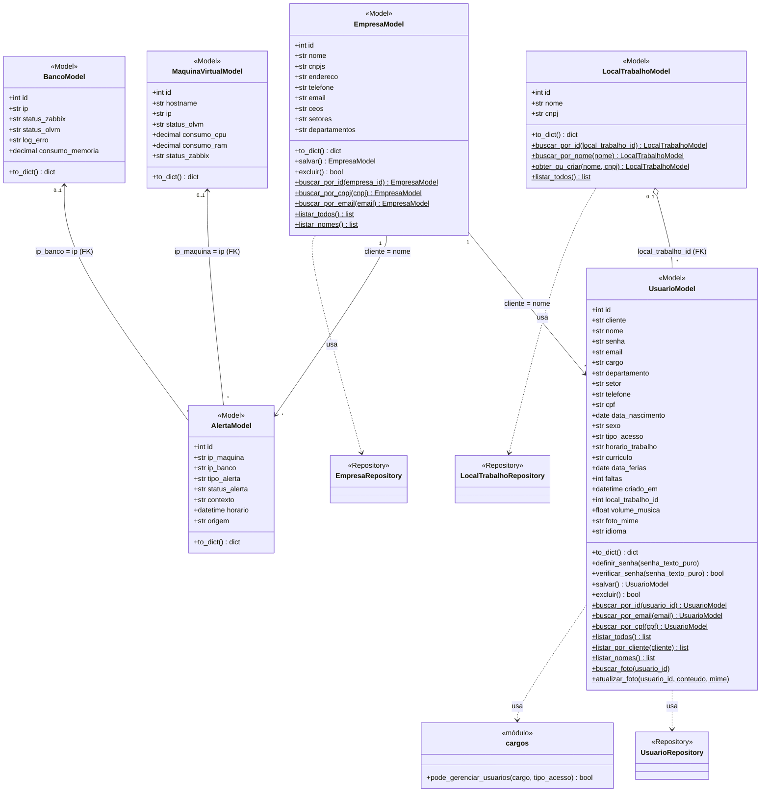

# Diagrama de classes do domínio

Classes implementadas em `backend/models/` e seus relacionamentos, de acordo com a estrutura de dados do sistema (`backend/database/banco.sql` e `backend/database/migracao.py`).

O código-fonte do diagrama (Mermaid) está em `diagrama-de-classes.mmd` e repetido no final deste arquivo.

## Classes

| Classe (Model) | Tabela | Papel no domínio |
|---|---|---|
| `EmpresaModel` | `empresa` | Empresa-cliente que assina o Nexus Air |
| `UsuarioModel` | `usuario` | Pessoa com acesso ao sistema (cargo, tipo de acesso, perfil) |
| `LocalTrabalhoModel` | `local_trabalho` | Empresa/local onde o usuário diz que trabalha |
| `AlertaModel` | `alerta` | Alerta de monitoramento (manual ou vindo do Zabbix) |
| `MaquinaVirtualModel` | `maquinas_virtuais` | Máquina virtual monitorada |
| `BancoModel` | `banco` | Banco de dados monitorado |

## Relacionamentos

| Relacionamento | Tipo | Multiplicidade | Base na estrutura de dados |
|---|---|---|---|
| `LocalTrabalhoModel` → `UsuarioModel` | **Agregação** | 0..1 para * | FK `usuario.local_trabalho_id` → `local_trabalho.id`, com `ON DELETE SET NULL`: o usuário continua existindo se o local for removido |
| `EmpresaModel` → `UsuarioModel` | Associação | 1 para * | `usuario.cliente` guarda o `empresa.nome` (sem FK declarada) |
| `EmpresaModel` → `AlertaModel` | Associação | 1 para * | `alerta.cliente` guarda o `empresa.nome` (sem FK declarada); toda consulta de alertas é filtrada por empresa |
| `AlertaModel` → `MaquinaVirtualModel` | Associação | * para 0..1 | FK `alerta.ip_maquina` → `maquinas_virtuais.ip` (a migração torna a coluna opcional, pois alertas do Zabbix podem não ter máquina cadastrada) |
| `AlertaModel` → `BancoModel` | Associação | * para 0..1 | FK `alerta.ip_banco` → `banco.ip` (opcional, pelo mesmo motivo) |

Dependências (linhas tracejadas): `EmpresaModel`, `UsuarioModel` e `LocalTrabalhoModel` usam seus repositórios para acessar o banco, e `UsuarioModel` usa `cargos.pode_gerenciar_usuarios` para calcular a permissão de gestão.

## Herança, composição e agregação

- **Herança:** não há. Nenhuma Model estende outra; todas são classes independentes.
- **Composição:** não há. Nenhuma Model tem existência dependente de outra (a exclusão de uma não apaga as demais).
- **Agregação:** uma, entre `LocalTrabalhoModel` (todo) e `UsuarioModel` (parte), explicada na tabela acima.

## Observações de coerência com o banco

- `AlertaModel` representa as colunas básicas de `alerta`. A tabela tem colunas adicionais criadas pela migração e tratadas pelo repositório (`cliente`, `severidade`, `descricao`, `recomendacao`, `criado_por`, `verificado`, `verificado_por`, `verificado_em`, `observacao_verificacao`, `zabbix_eventid`, `zabbix_estado`, `zabbix_host`, `zabbix_pendente`).
- `UsuarioModel` não expõe `foto_perfil` (o binário da foto); o acesso é feito por `buscar_foto` e `atualizar_foto`, e o atributo `foto_mime` indica o tipo.
- Tabelas sem Model dedicada, tratadas por services: `tarefa` e `alerta_tarefa` (chave `cliente`, também ligada à empresa pelo nome), além de `usuario_suporte`, `relatorio_alerta` e `relatorio` do `banco.sql`. Por isso não aparecem no diagrama.

## Código do diagrama (Mermaid)

